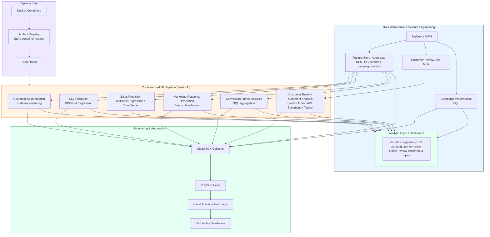
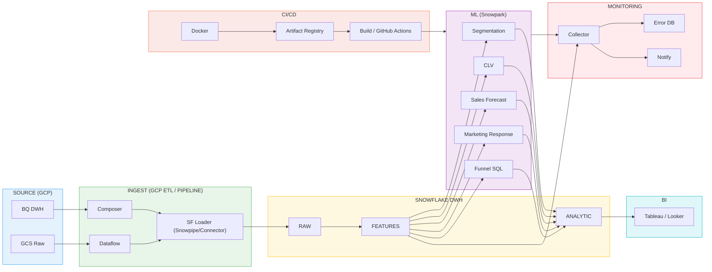
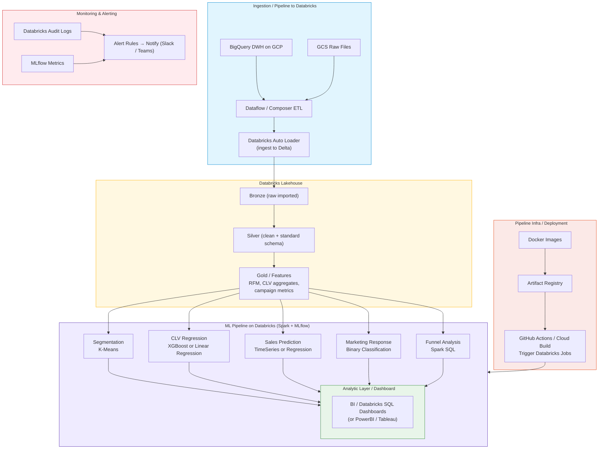

# Analytic-Platform（GCP, Snowflake, Databricks）

[English](README.md) | [日本語](README.ja.md) | [简体中文](README.zh-CN.md)

図のラベルは、すべての言語版で英語に統一しています。

## 分析目的

| 目的 | 必要なデータ | 手順・実装 | モデル種別 |
|---|---|---|---|
| **顧客セグメンテーション** | 顧客属性、取引履歴 | 1. 顧客の取引データをDWHへ取り込む。 2. RFM特徴量（最終購入からの経過期間・購入頻度・購入金額）を集計する。 3. K-Meansで顧客を分類する（Vertex AI / Spark MLlib / scikit-learn）。 | クラスタリング（教師なし学習） |
| **顧客生涯価値（CLV）予測** | 取引、購入日、顧客属性 | 1. 顧客別の過去売上を計算する。 2. 回帰モデル（線形回帰、XGBoost）で将来売上を予測する。 3. 高価値顧客のセグメントを分析層へ出力する。 | 回帰モデル |
| **キャンペーン効果分析** | キャンペーンデータ（表示、クリック、開封） | 1. キャンペーン別のクリック・開封・コンバージョンを集計する。 2. CTRとコンバージョン率を計算する。 3. セグメント別に効果を比較する。 | — |
| **売上予測** | 過去の売上、販促、季節性 | 1. 店舗・ブランド別、期間別に売上を集計する。 2. 販促、季節性、祝日、外部要因の特徴量を作成する。 3. 線形回帰または時系列モデル（ARIMA、Prophet、Vertex AI Forecasting）を学習する。 4. 予測を分析層へ出力し、ダッシュボードや計画に利用する。 | 回帰・時系列モデル |
| **コンバージョンファネル分析** | Webサイト・アプリの行動データ | 1. セッション、ページ閲覧、コンバージョンイベントを抽出する。 2. ページ閲覧 → カート追加 → 購入のファネルを作成する。 3. 各段階の離脱率を計算する。 | — |
| **マーケティング反応予測** | キャンペーンと顧客行動 | 1. キャンペーン・顧客属性・行動特徴量を結合する。 2. 反応の有無を予測する二値分類モデルを学習する。 3. 新しいキャンペーンの反応を予測する。 | 分類モデル |
| **顧客レビュー分析（GCP）** | レビュー本文、評価、商品メタデータ | 1. レビュー本文を収集してDWHへ取り込む。 2. テキストを前処理する（トークン化、ストップワード除去、見出し語化）。 3. 学習済みモデル（例：Vertex AI Text Sentiment API）で感情分析する。 4. 肯定・中立・否定に分類する。 5. LDAやBERTopicで「配送の問題」「品質への不満」「機能要望」などのテーマを抽出する。 6. 商品・ブランド・セグメント別に感情とテーマを集計し、改善箇所を把握する。 7. 分析層やBIダッシュボードへ結果を出力する。 | 自然言語処理（感情分析・トピックモデリング） |

## GCP上の分析基盤

## Snowflake上の分析基盤

## Databricks上の分析基盤

