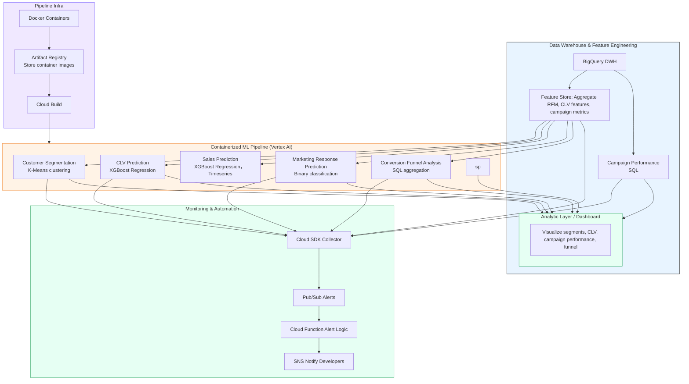
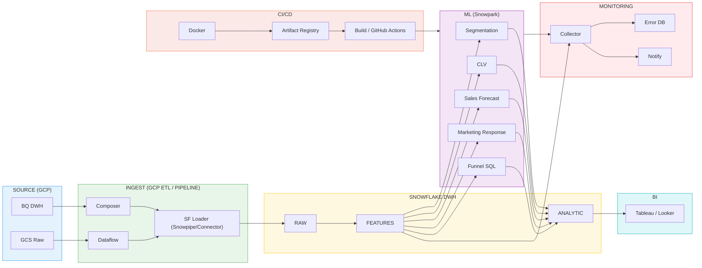
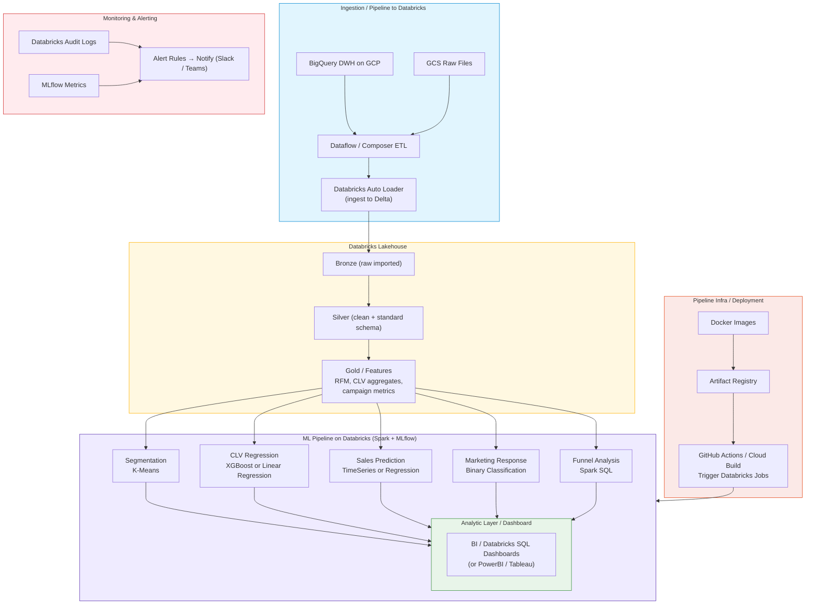

# Analytic-Platform（GCP, Snowflake, Databricks）

## Analytics Objectives
| Objective                                    | Data Needed                                   | Steps / Implementation                                                                                                                                                                                                                                                                                                   | Model Type                      |
| -------------------------------------------- | --------------------------------------------- | ------------------------------------------------------------------------------------------------------------------------------------------------------------------------------------------------------------------------------------------------------------------------------------------------------------------------ | ------------------------------- |
| **Customer Segmentation**                    | Customer demographics, transaction history    | 1. Load customer transaction data to DWH. 2. Aggregate RFM features (Recency, Frequency, Monetary). 3. Cluster customers using K-Means (Vertex AI / Spark MLlib / scikit-learn).                                                                                                                                   | clustering model (unsupervised) |
| **Customer Lifetime Value (CLV) Prediction** | Transactions, purchase dates, demographics    | 1. Compute historical revenue per customer. 2. Use regression model (linear regression, XGBoost) to predict future revenue. 3. Output high-value segments to analytic layer.                                                                                                                                       | regression model                |
| **Campaign Performance Analysis**            | Campaign dataset (impressions, clicks, opens) | 1. Aggregate clicks, opens, conversions per campaign. 2. Compute CTR, conversion rate. 3. Compare campaign effectiveness across segments.                                                                                                                                                                          | -                               |
| **Sales Prediction**          | Historical sales, promotions, seasonality     | 1. Aggregate historical sales by shop / brand and time periods. 2. Feature engineering: promotions, seasonality, holidays, external factors. 3. Train linear regression or time series models (ARIMA, Prophet, Vertex AI Forecasting). 4. Output predicted sales to analytic layer for dashboards and planning. | regression / time series model  |
| **Conversion Funnel Analysis**               | Website/app behavior data                     | 1. Extract sessions, page views, conversion events. 2. Build funnel: page view → add to cart → purchase. 3. Calculate drop-off rates at each stage.                                                                                                                                                                | -                               |
| **Marketing Response Prediction**            | Campaign + customer behavior                  | 1. Merge campaign, demographic, and behavioral features. 2. Train binary classification model (responded / not). 3. Predict for new campaigns.                                                                                                                                                                     | classification model            |

## Analytic-Platform on GCP

## Analytic-Platform on Snowflake

## Analytic-Platform on Databricks
