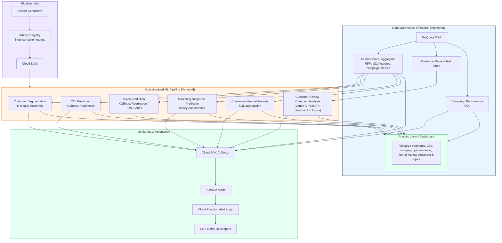
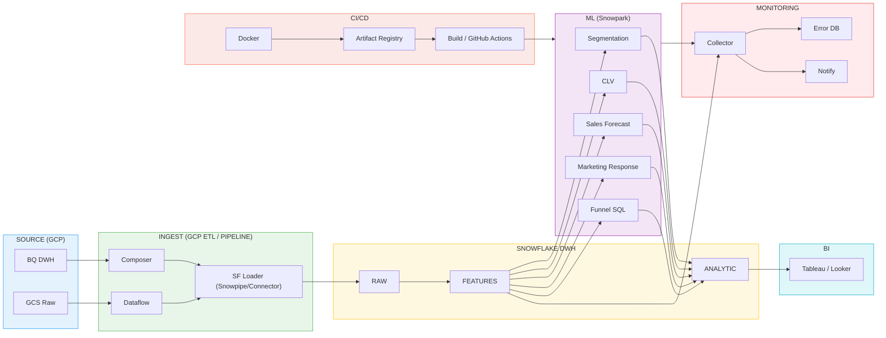
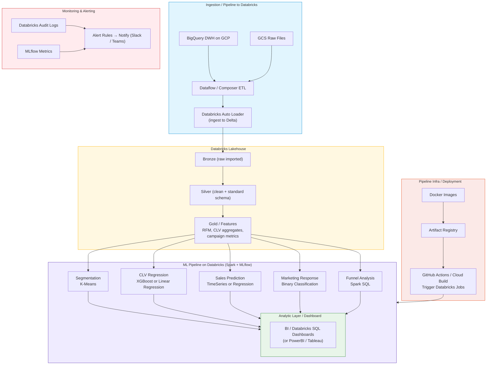

# Analytic-Platform（GCP, Snowflake, Databricks）

[English](README.md) | [日本語](README.ja.md) | [简体中文](README.zh-CN.md)

所有语言版本的图表均使用英文标签。

## 分析目标

| 目标 | 所需数据 | 步骤与实现 | 模型类型 |
|---|---|---|---|
| **客户分群** | 客户属性、交易历史 | 1. 将客户交易数据加载到 DWH。 2. 聚合 RFM 特征（最近购买间隔、购买频率、购买金额）。 3. 使用 K-Means 对客户分群（Vertex AI / Spark MLlib / scikit-learn）。 | 聚类模型（无监督学习） |
| **客户生命周期价值（CLV）预测** | 交易、购买日期、客户属性 | 1. 计算每位客户的历史收入。 2. 使用回归模型（线性回归、XGBoost）预测未来收入。 3. 将高价值客户分群输出到分析层。 | 回归模型 |
| **营销活动效果分析** | 营销活动数据（曝光、点击、打开） | 1. 按活动聚合点击、打开与转化。 2. 计算 CTR 与转化率。 3. 比较各分群中的活动效果。 | — |
| **销售预测** | 历史销售、促销、季节性 | 1. 按门店、品牌与时间段聚合销售。 2. 构建促销、季节性、节假日与外部因素特征。 3. 训练线性回归或时间序列模型（ARIMA、Prophet、Vertex AI Forecasting）。 4. 将预测输出到分析层，用于仪表板与业务规划。 | 回归 / 时间序列模型 |
| **转化漏斗分析** | 网站 / 应用行为数据 | 1. 提取会话、页面浏览与转化事件。 2. 构建页面浏览 → 加入购物车 → 购买的漏斗。 3. 计算各阶段的流失率。 | — |
| **营销响应预测** | 营销活动与客户行为 | 1. 合并活动、客户属性与行为特征。 2. 训练二分类模型，预测是否响应。 3. 预测新活动的客户响应。 | 分类模型 |
| **客户评论分析（GCP）** | 评论文本、评分、商品元数据 | 1. 收集客户评论并加载到 DWH。 2. 进行文本预处理（分词、去停用词、词形还原）。 3. 使用预训练模型（如 Vertex AI Text Sentiment API）进行情感分析。 4. 将评论分为正面、中性、负面。 5. 使用 LDA、BERTopic 提取“配送问题”“质量投诉”“功能需求”等主题。 6. 按商品、品牌、客户群聚合情感与主题，识别改进方向。 7. 将结果输出到分析层或 BI 仪表板。 | NLP（情感分析与主题建模） |

## GCP 分析平台

## Snowflake 分析平台

## Databricks 分析平台

